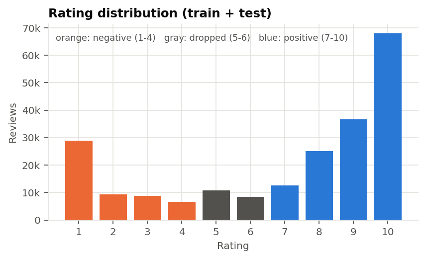
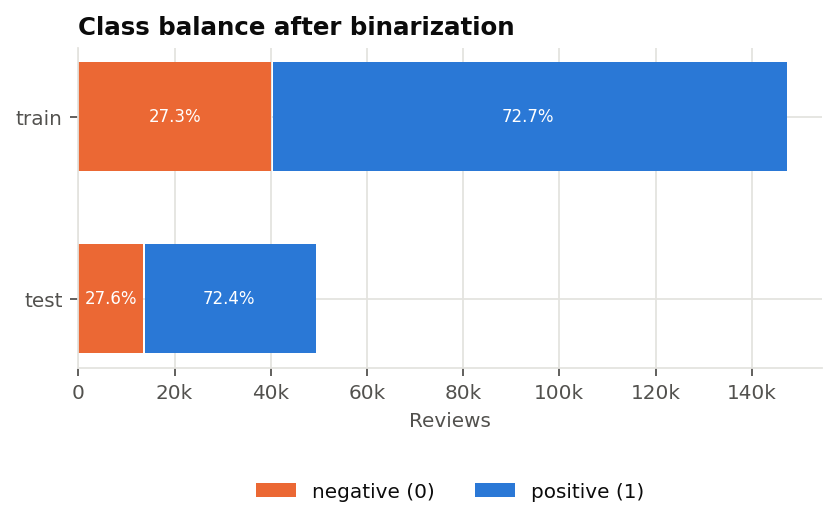
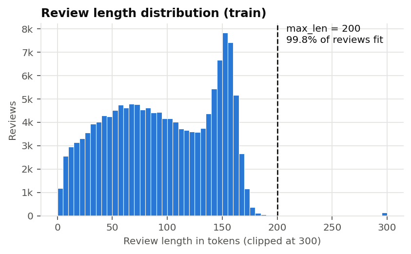
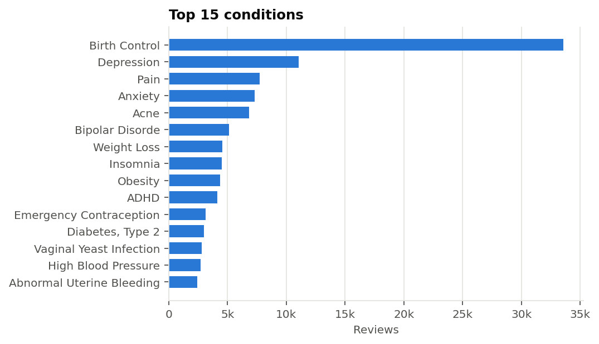
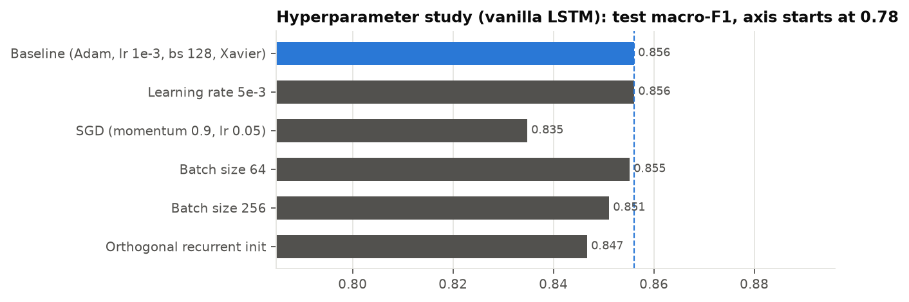
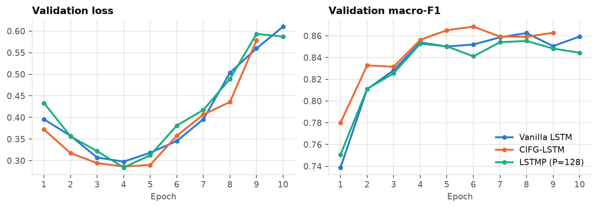
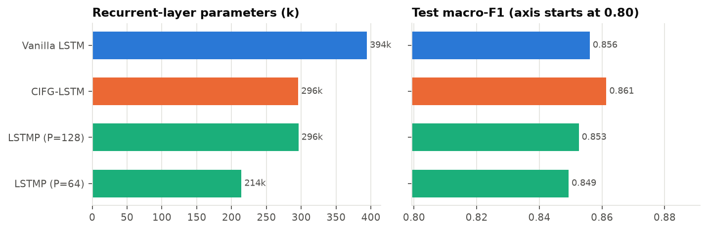
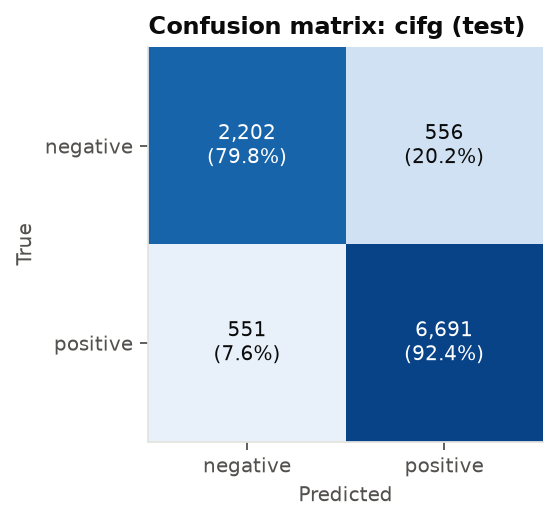

# Sentiment Classification of Drug Reviews with Hand-Implemented LSTM Variants

*Advanced NLP: Lab Project on Recurrent Neural Networks, 2026/2027. Team: {{TEAM}}. Code: {{REPO_URL}}*

## 1. Goal of the task

We classify patient reviews from Drugs.com (UCI Drug Review dataset) as **positive** (rating ≥ 7) or **negative** (rating ≤ 4); neutral reviews (5–6) are discarded. The goal is to compare a vanilla LSTM baseline with two non-vanilla cells from the appendix, the **Coupled Input-Forget Gate LSTM (CIFG)** and the **LSTM with recurrent Projection (LSTMP)**, and to study how optimization hyperparameters affect the baseline. All cells are written from scratch with `nn.Linear` as the only linear operation; no built-in recurrent module (`nn.LSTM`, `nn.LSTMCell`, `nn.RNN`) is used, which a unit test checks automatically.

## 2. Exploratory data analysis

The dataset provides an official train file ({{N_TRAIN_RAW}} reviews) and test file ({{N_TEST_RAW}} reviews). After dropping the {{DROPPED}} neutral reviews, {{N_TRAIN_KEPT}} train and {{N_TEST_KEPT}} test reviews remain. Ratings are strongly polarized (most reviews are 10 or 1), which makes the binary task well defined, but the classes are **imbalanced**: {{POS_TRAIN}} positive in train and {{POS_TEST}} in test. We therefore use **macro-F1** as the model-selection and headline metric, since accuracy alone would reward predicting the majority class (a constant "positive" classifier already reaches ≈{{POS_TEST}} accuracy).

{width=48%} {width=48%}

Texts are HTML-unescaped (the raw file contains entities such as `&#039;`), lowercased, stripped of quotes and tokenized with a regular expression (words, contractions and the punctuation `! ? . ,`). Reviews have a mean length of {{LEN_MEAN}} tokens (median {{LEN_MEDIAN}}, 95th percentile {{LEN_P95}}); the distribution has a sharp drop near 160 tokens, which reflects a length limit on Drugs.com. A maximum sequence length of **200** keeps {{COVERAGE}} of reviews untruncated. The reviews cover {{N_COND}} conditions and {{N_DRUGS}} drugs, dominated by birth control, depression and pain.

{width=48%} {width=48%}

**Splits and subsampling.** The official test file is the test set. The official train file is split 90/10 (stratified, seed 42) into train and validation. To fit free-GPU budgets we draw stratified subsamples of **{{N_TRAIN}} train / {{N_VAL}} validation / {{N_TEST}} test** reviews; stratification preserves the original class ratio, so no artificial imbalance is introduced. The vocabulary (min frequency 2, at most 20k types, `<pad>`=0, `<unk>`=1) is built on the training subset only, giving {{VOCAB}} tokens.

## 3. Modeling approach

**Architecture.** Every model shares the same pipeline: token ids → `nn.Embedding` (128-d) → one recurrent layer built from the chosen cell (hidden size H = 256) → dropout 0.3 → `nn.Linear` → 2 logits. A generic `RecurrentLayer` unrolls any cell over time and supports stacking with inter-layer dropout. Sequences are padded per batch; at padded positions the state is frozen with a mask, so the representation fed to the classifier is the hidden state at each review's **true last token**. Gate pre-activations are fused (one `nn.Linear` for x, one bias-free `nn.Linear` for h, so each gate has exactly one bias as in the equations), and W_x·x_t is computed for all time steps in a single matrix product before the time loop.

**Vanilla LSTM (baseline)**

```
i_t = σ(W_hi h_{t-1} + W_xi x_t + b_i)     f_t = σ(W_hf h_{t-1} + W_xf x_t + b_f)
o_t = σ(W_ho h_{t-1} + W_xo x_t + b_o)     g_t = tanh(W_hg h_{t-1} + W_xg x_t + b_g)
c_t = f_t ⊙ c_{t-1} + i_t ⊙ g_t            h_t = o_t ⊙ tanh(c_t)
```

**CIFG-LSTM.** The input gate is tied to the forget gate, i_t = 1 − f_t; the rest is unchanged. The cell can only write new content in proportion to what it forgets, which Greff et al. (2015) found to cost little accuracy while removing a full gate, i.e. **25 % of the recurrent parameters** (3 instead of 4 gate blocks).

**LSTMP.** Gates are computed from x_t and the *projected* previous state h_{t-1} ∈ ℝ^P; the cell state stays in ℝ^H:

```
m_t = o_t ⊙ tanh(c_t),     h_t = W_p m_t + b_p,     W_p ∈ ℝ^{P×H}, P < H
```

Because the four recurrent matrices act on a P-dimensional state, their cost drops from 4H² to 4HP, at the price of one H×P projection. With H = 256 and P = 128, LSTMP keeps a 256-d memory with roughly the parameter budget of CIFG. Sak et al. (2014) introduced it to make large acoustic models cheaper. Both variants therefore target **efficiency**: can we keep the vanilla accuracy with fewer parameters?

**Parameter counts** (formulae checked by unit tests; D = 128 input, H = 256, P = 128):

{{PARAMS_TABLE}}

**Tests.** `tests/test_cells.py` checks output shapes, the parameter formulae, i_t = 1 − f_t for CIFG, agreement of the vanilla cell with a direct evaluation of the equations, invariance of the final state to extra padding, and that `src/` contains no built-in recurrent module.

## 4. Hyperparameter design choices

**Shared protocol.** Same splits, same seed (42), same seeded length-bucketed batch order, cross-entropy loss, gradient-norm clipping at 1.0, at most 10 epochs with early stopping on validation macro-F1 (patience 3). The checkpoint with the best validation macro-F1 is evaluated once on the test set. Forget-gate biases are initialised to 1 and other biases to 0. **Baseline:** Adam, learning rate 10⁻³, batch size 128, Xavier-uniform initialisation, embedding 128, hidden 256, dropout 0.3. These are standard settings for LSTM text classifiers; embedding and hidden sizes were kept moderate so that each run fits a free Colab GPU session.

**Study (vanilla LSTM, one factor changed at a time):** learning rate 10⁻³ vs 5·10⁻³; Adam vs SGD (momentum 0.9, lr 0.05); batch size 64 / 128 / 256; Xavier-uniform vs orthogonal recurrent weights.

{{HPARAM_TABLE}}

{width=80%}

{{HPARAM_FINDINGS}}

## 5. Final model performance and evaluation

**Architecture comparison** (identical hyperparameters, test set):

{{ARCH_TABLE}}

{width=90%}

{{ARCH_FINDINGS}}

{width=90%}

{{PROJ_FINDINGS}}

**Final model.** {{BEST_SUMMARY}}

{width=42%}

{{CM_SENTENCE}}

## 6. Limitations and potential improvements

- **Context from both directions:** a bidirectional layer, or attention pooling over all hidden states, would avoid relying on the last state alone, which is a bottleneck for long reviews where the verdict appears early.
- **Pretrained embeddings** (GloVe, fastText or domain embeddings trained on medical text) would help with rare drug names and side-effect vocabulary that a 40k-review vocabulary covers poorly.
- **Other cells:** the Working Memory Connections (WMC) cell, which lets the cell state drive the gates, is a natural fourth variant; a stacked 2-layer model is already supported by the code.
- **Class imbalance:** class-weighted loss or threshold tuning on the validation set could raise recall on the negative class without resampling.
- **Task framing:** a 3-class setting keeping neutral 5–6 reviews, or rating regression, would be more informative and harder.
- **More data and search:** training on the full 132k training reviews and a systematic search (several seeds, joint lr/batch-size grid) would give more reliable conclusions; our results come from a single seed, so differences of a few thousandths of F1 should not be over-interpreted.

**References.** Greff et al., *LSTM: A Search Space Odyssey*, 2015. Sak et al., *Long Short-Term Memory Recurrent Neural Network Architectures for Large Scale Acoustic Modeling*, Interspeech 2014. Landi et al., *Working Memory Connections for LSTM*, Neural Networks, 2021. Gräßer et al., *Aspect-Based Sentiment Analysis of Drug Reviews Applying Cross-Domain and Cross-Data Learning*, 2018 (dataset).
